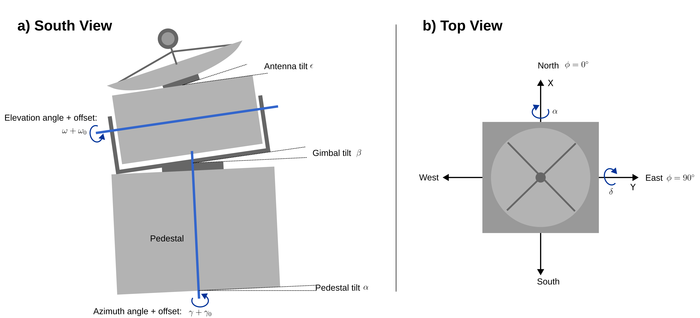

<div align="center">
  
  <!-- <h1>SunscanPy</h1> -->
  <p><em>A python library to calibrate the pointing of your weather or cloud radar based on the position of the Sun!</em></p>
  <p>
    <a href="https://doi.org/10.5281/zenodo.18862011"></a>
    <a href="https://doi.org/10.5194/amt-19-2961-2026"></a>
  </p>
</div>

## Description

Precise knowledge of the pointing direction is essential for weather and cloud radars. Radars with scanning capability can be calibrated using the sun as a microwave emitting target with a precisely defined position in the sky.
SunscanPy provides tools to evaluate radar measurements of the sun, derive the mispointing of your antenna and actively correct misalignments using the scanner motors.

<div align="center">
  
  <p><em>Some inaccuracies of a two axis scanner, which can be analyzed and corrected using SunscanPy</em></p>
</div>

## Installation
```bash
pip install sunscanpy
```

### From source

```bash
git clone https://github.com/Ockenfuss/sunscanpy.git
cd sunscanpy
pip install -e .
```

## Usage
For usage information, see the two tutorial jupyter notebooks provided in the examples subfolder:
- [Tutorial Part 1: Single sunscan evaluation](examples/Tutorial_Part1_Sunscan.ipynb)
- [Tutorial Part 2: Scanner parameter estimation](examples/Tutorial_Part2_Scanner.ipynb)

For a detailed introduction and evaluation of SunscanPy, see the [reference publication](https://doi.org/10.5194/amt-19-2961-2026)


## Scanner Visualization
`sunscan/scanner_animation_streamlit.py` contains a streamlit application to visualize the orientation of the scanner, given a set of axis positions and scanner parameters. To run it:
```
pip install sunscanpy[dev] # needs streamlit, which is not installed by default with sunscanpy
streamlit run sunscan/scanner_animation_streamlit.py
```

## Contributing
See Contributing.md

## Citation
When using SunscanPy, please cite:
Ockenfuß, P., Köcher, G., Bauer-Pfundstein, M., and Kneifel, S.: A novel framework for automatic scanning radar pointing calibration using the Sun, Atmos. Meas. Tech., 19, 2961–2984, https://doi.org/10.5194/amt-19-2961-2026, 2026.

## License

SunscanPy  © 2025 by Paul Ockenfuß, Gregor Köcher, Ludwig-Maximilians Universität München is licensed under CC BY-SA 4.0. To view a copy of this license, visit https://creativecommons.org/licenses/by-sa/4.0/


## Authors

- Paul Ockenfuß
- Gregor Köcher
